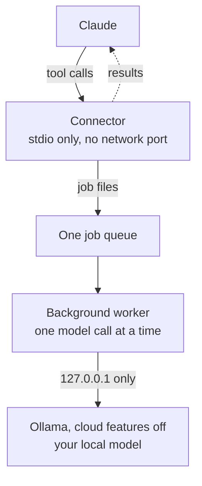

# Local Delegate

**Let Claude hand routine reading and first drafts to a model running on your own computer:
strictly local, sized to your hardware, and only with your OK.**


Local Delegate is a plugin for Claude (Claude Code, and Cowork in the Claude desktop app). It pairs
a skill, the instructions Claude follows, with a small local connector (an MCP server) that sends
routine work to an [Ollama](https://ollama.com) model on your computer: digesting long reports and
logs, triaging failed test runs, summarizing letters and forms, sorting job postings, translating,
and first drafts from your notes.

Version 0.4.1. It runs on Windows 11 only for now, and it is field-tested on one Windows 11
computer.

## Why

- **Save cloud tokens on bulk reading.** In the example below, reading a 66 KB report would cost
  Claude about 35k tokens; handing it to the local model saves about 20k of them.
- **Keep private text on your computer.** In file-only mode, the result is written to a file on
  your machine and Claude sees only its path.
- **Put idle hours to work.** Long, careful runs can wait for tonight; quick ones run now.
- **Stay in control.** Every run is offered as options with ready time, tokens saved and redo
  risk. Nothing runs until you pick one.

## What it looks like

You ask Claude to catch up on a long report. Claude gets an estimate and asks you:

```text
Digest reports or logs: 1 input(s), 65.8k chars. How should it run? (priority: balanced)
1. Local careful, now (recommended): Ready ~15:33 (13-22 min) · saves ~20k tokens (~15k allowing for redos) · reasons briefly first · ~8% redo risk (starting guess)
2. Claude now: Ready in ~26 s · uses ~35k Claude tokens
3. Local fast, now: Ready ~15:25 (5-9 min) · saves ~20k tokens (~12k allowing for redos) · answers directly · ~15% redo risk (starting guess)
4. Local deep, tonight: Starts 23:00, ready by ~tomorrow 00:33 · saves ~20k tokens (~16k allowing for redos) · reasons longer, then fixes what the checks flag · ~5% redo risk (starting guess)
```

These figures use the reference computer's calibration (an 8 GB graphics card and 32 GB of
memory); yours come from your own. Small jobs, like defining a word, Claude simply does itself:
handing them off would cost more than it saves.

## How it works



- **Scripts first.** Test counts, file lists, hashes, dates and keyword search are computed exactly
  by scripts, and large inputs are trimmed before the model reads them.
- **Checked answers.** Every quote the model cites is matched against the file, and deep runs get
  one fix-up pass on whatever the checks flag.
- **Budgeted reasoning.** Each level (fast, careful, deep) has a hard reasoning budget, so a simple
  question never turns into an hour of hidden reasoning.
- **Runs while you're away.** Jobs run in a background worker outside the app, so they keep going
  overnight even if you close Claude.

## Safety at a glance

| Guarantee | How it's enforced |
|---|---|
| The model's work stays on your computer | Checked before every run: Ollama at 127.0.0.1 only and listening on loopback only, cloud features proven off in Ollama's own log, and the model downloaded (no `:cloud` models). Any failure blocks the run. |
| Nothing runs without you | Every run needs your pick, and Claude asks with the options first. Where your app's tool permissions allow it, you can also have it ask before every `local_run` call. |
| Secrets stay out | Key stores, `.env` files, SSH and cloud credentials, browser profiles and similar files are never read; known key formats are blanked before text reaches the model. |
| No hidden traffic | Standard-library Python, no dependencies, no telemetry and no downloads. The only network connection is to Ollama on 127.0.0.1. |
| Your data stays yours | Settings, calibration, jobs and results live in `%LOCALAPPDATA%\local-delegate`; logs keep metadata only. |

What does reach Claude is whatever a tool returns (a digest, a checklist, a draft), which becomes
part of your conversation. Full details are in [docs/PRIVACY.md](docs/PRIVACY.md) and
[SECURITY.md](SECURITY.md).

## Privacy policy

Local Delegate's author collects nothing: there is no account, telemetry, analytics or crash
reporting.

- **What it reads:** only the files you or Claude name, inside the allowed folders on your
  computer (your user folder by default), and never secret stores.
- **How it's used and stored:** files are read and processed on your computer. Settings,
  calibration, jobs, results and logs stay in `%LOCALAPPDATA%\local-delegate`.
- **Sharing:** prompts go only to Ollama at `127.0.0.1`. What a tool returns becomes part of your
  Claude conversation, which Anthropic handles under its own policies. Nothing goes to the author
  or to any other service.
- **Retention:** jobs and file-only results are deleted after 14 days (the `retention_days`
  setting). Settings, rule sheets and the metadata-only log stay until you delete them.
- **Contact:** questions in this repository's Issues tab; security or privacy problems privately,
  as [SECURITY.md](SECURITY.md) describes.

The full policy: [docs/PRIVACY.md](https://github.com/emanuelaviv/local-delegate/blob/main/docs/PRIVACY.md).

## Requirements

| | Needed | Tested |
|---|---|---|
| Computer | Windows 11 (Windows 10 is untested) | Windows 11 |
| Memory | 32 GB for the default 27B model, which takes about 18 GB; less with a smaller model | 32 GB, RTX 5060 8 GB |
| Python | 3.11 or newer, as the `python` command | 3.11 to 3.14 (tests), 3.14 (in use) |
| Ollama | 0.34.4 or newer, able to turn cloud features off | 0.40.8 |
| Claude | Claude Code, or a Cowork session in the Claude desktop app on the same computer (plain chat can't start a local connector) | both |

## Install

The full walkthrough, with a check after every step and fixes for common problems, is in
**[docs/INSTALL.md](docs/INSTALL.md)**. In short:

1. **Python.** Install Python 3.11 or newer from [python.org](https://www.python.org/downloads/)
   (with the traditional installer, tick **Add python.exe to PATH**), then check that
   `python --version` works in a new terminal.
2. **Ollama and a model.** Install [Ollama](https://ollama.com/download), then run
   `ollama pull qwen3.8:27b-q4_K_M` (about 17 GB; INSTALL covers smaller computers).
3. **The plugin.**
   - Claude desktop app: **Customize > Plugins > Add > Add marketplace**, enter
     `emanuelaviv/local-delegate`, then add **Local Delegate**.
   - Claude Code: `claude plugin marketplace add emanuelaviv/local-delegate`, then
     `claude plugin install local-delegate@local-delegate`.
4. **Set up and calibrate.** In Claude Code or a Cowork session on that computer, say *"set up the
   local model"*. Claude shows the exact changes to Ollama's settings and asks first; Ollama then
   restarts. Then say *"calibrate the local model"* (up to 12 minutes).
5. **Check.** Say *"local status"*. You should see `ready: true`, with every local-only check
   passing.

## Using it

Work as usual: Claude offers the local model when a task fits. To be explicit, say:

- *"do this locally"*, *"keep this on my computer"*, *"queue it for tonight"*, *"deep, tonight"*
- *"save tokens today"* or *"I'm short on time"* (switches the preset to saver or rush)
- *"local status"*, *"check the worker"*, *"what finished overnight?"*

The 13 tasks, the options, presets, overnight runs, rule sheets, settings, the command line, and
use from Codex or Cursor are in **[docs/USAGE.md](docs/USAGE.md)**.

## Example prompts

- *"Digest `C:\Users\you\Documents\q3-report.md` with the local model: decisions, risks and dates."*
- *"The tests failed. Triage `build\test-output.log` locally and tell me what broke first."*
- *"Summarize `letters\water-notice.txt` on my computer: what do I need to do, and by when? Keep
  the result local."*
- *"Compare these five job postings with my CV tonight; I'll read the checklists in the morning."*
- *"Save tokens today: do anything long locally."*

To try it without your own files, use the fictional samples in [examples/](examples/), for
example *"Triage the failures in examples/sample-pytest-log.txt with the local model."*

## What it runs, reads and sends

- **Runs** a Python connector (Claude starts it with `python`) and a background worker. If Windows won't let
  the worker start directly, it's started through Windows' process service (WMI). For its checks
  it runs read-only system queries: PowerShell inline commands with `-ExecutionPolicy Bypass`
  (which program listens on Ollama's port, the graphics card's name), `nvidia-smi`, `netstat`,
  `tasklist` and registry reads. Diff tasks run read-only `git` commands. Only during setup, after
  you approve, it changes Ollama's settings and restarts Ollama, which gets your
  user environment as when you start it from the Start menu. While jobs are pending on mains
  power, it asks Windows not to sleep.
- **Reads** files you or Claude name, inside the allowed folders (your user folder by default),
  and never secret stores.
- **Writes** only in `%LOCALAPPDATA%\local-delegate`, plus Ollama's settings during the setup you
  approve.
- **Sends** prompts only to Ollama at 127.0.0.1, and tool results to Claude in your conversation.

## Limits

- Windows only for now; help with Linux and macOS is welcome (see [CONTRIBUTING.md](CONTRIBUTING.md)).
- Local models make mistakes. Results are drafts and extractions to check, not verdicts; exact
  facts come from scripts.
- Your approval is requested by the skill's instructions and, where your app supports it, by its
  tool permissions. The connector itself can't tell whether you said yes.
- Speed depends on your hardware. On a typical desktop, writing is the bottleneck: about 4 tokens a
  second for a 27B model.

## Contributing, security and license

- Bugs and ideas: open an issue in this repository's Issues tab. Please don't paste private file
  contents or logs with personal data.
- Security problems: report them privately, as [SECURITY.md](SECURITY.md) describes.
- Code: [CONTRIBUTING.md](CONTRIBUTING.md). Design notes: [docs/DESIGN.md](docs/DESIGN.md).
  Changes: [CHANGELOG.md](CHANGELOG.md).
- License: [MIT](LICENSE).

Built with Claude (Anthropic) to the author's specification. Not affiliated with Anthropic, Ollama
or the Qwen team.
